<!-- ============================== BANNER ============================== -->

  

<!-- ========================= TYPING ANIMATION ========================= -->

  

<!-- ============================ SOBRE MIM ============================= -->
## ⬢ Sobre mim

Oi, eu sou o Gabriel. Estou no 2º semestre de **Engenharia de Software na UNIFAE** e aprendo do jeito que mais funciona pra mim: construindo coisas e publicando aqui.

- ⬢ Em C, fiz programas de terminal que vão de uma calculadora a um compactador de arquivos com RLE.
- ⬢ Em HTML e CSS, montei páginas que estão no ar pelo GitHub Pages, incluindo o meu currículo.
- ⬢ Em JavaScript, fiz uma busca de CEP que consulta uma API, um teste de digitação e um gerador de paletas de cores.
- ⬢ Meu dia a dia de código passa pelo **VS Code**, pelo **Dev-C++** e pelo **Claude Code**.
- ⬢ Também fiz o curso de **Informática Profissional** no Grupo Data Center.
- ⬢ Agora estou procurando **estágio em desenvolvimento de sistemas**, para aplicar o que estudo em programação e banco de dados.

<!-- =========================== TECNOLOGIAS ============================ -->
## ⬢ Tecnologias

  

  
  
  
  

<!-- ============================= PROJETOS ============================= -->
## ⬢ Projetos

  
  
  
  <!--
    Para adicionar outro projeto, copie um dos blocos <a>...</a> acima e troque
    o nome do repositório nos dois lugares (no href e no parâmetro repo=).
  -->

  
  

<!-- ========================== GITHUB STATS =========================== -->
## ⬢ Números do GitHub

  
  

  

<!-- ========================= ACTIVITY GRAPH ========================== -->

  

<!-- ============================= TROFÉUS ============================== -->
## ⬢ Troféus

  

<!-- ============================== SNAKE =============================== -->

  <picture>
    <source media="(prefers-color-scheme: dark)" srcset="https://raw.githubusercontent.com/Paxtel-Source/Paxtel-Source/output/snake-dark.svg">
    <source media="(prefers-color-scheme: light)" srcset="https://raw.githubusercontent.com/Paxtel-Source/Paxtel-Source/output/snake-light.svg">
    
  </picture>

<!-- ========================== REDES SOCIAIS =========================== -->
## ⬢ Onde me encontrar

  
  
  

<!-- ============================== RODAPÉ ============================== -->

  

